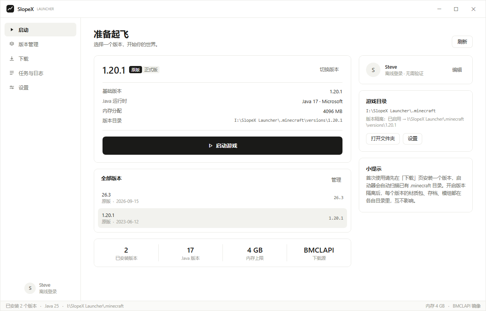
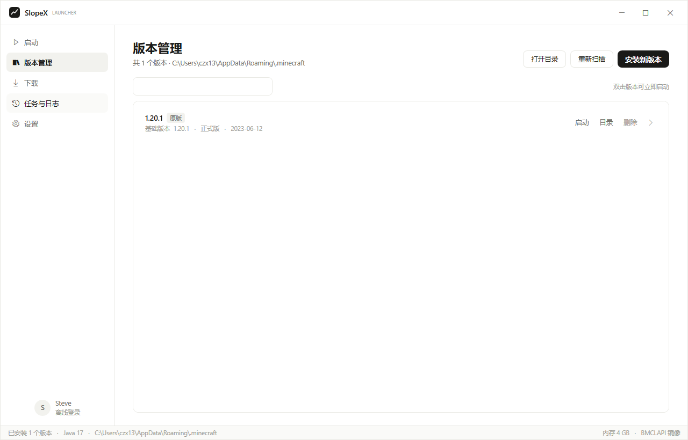
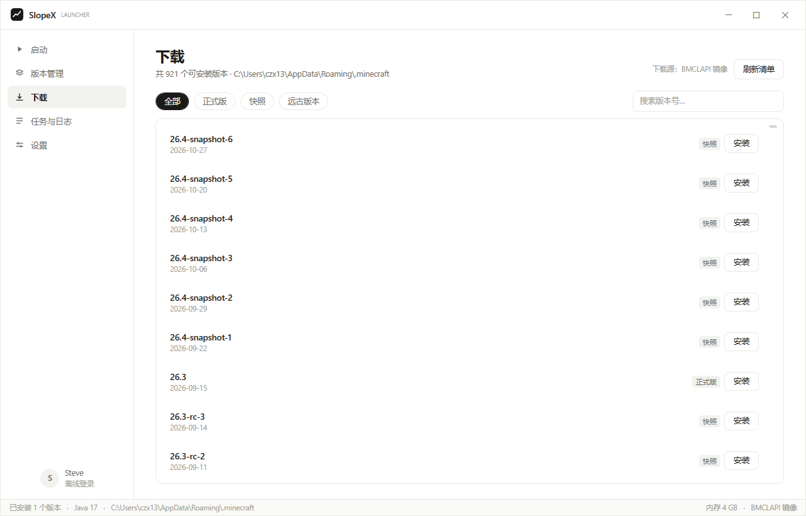
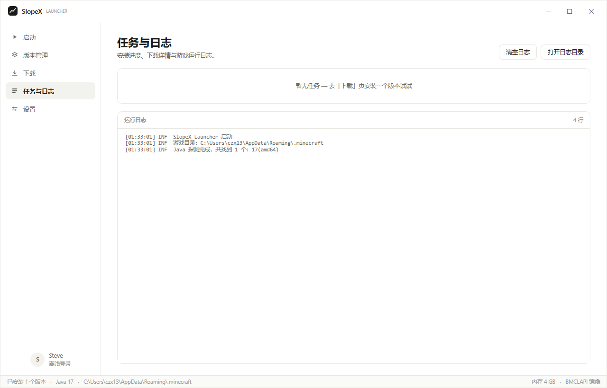
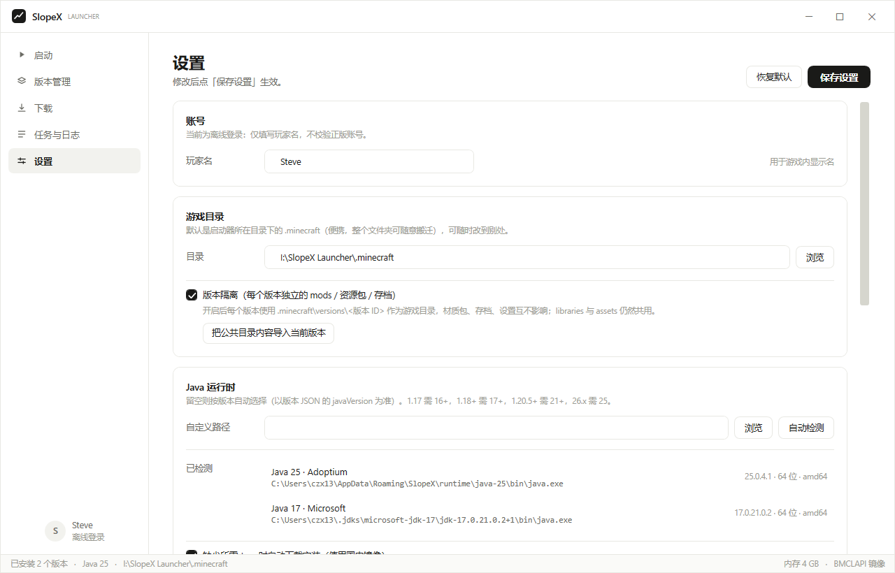
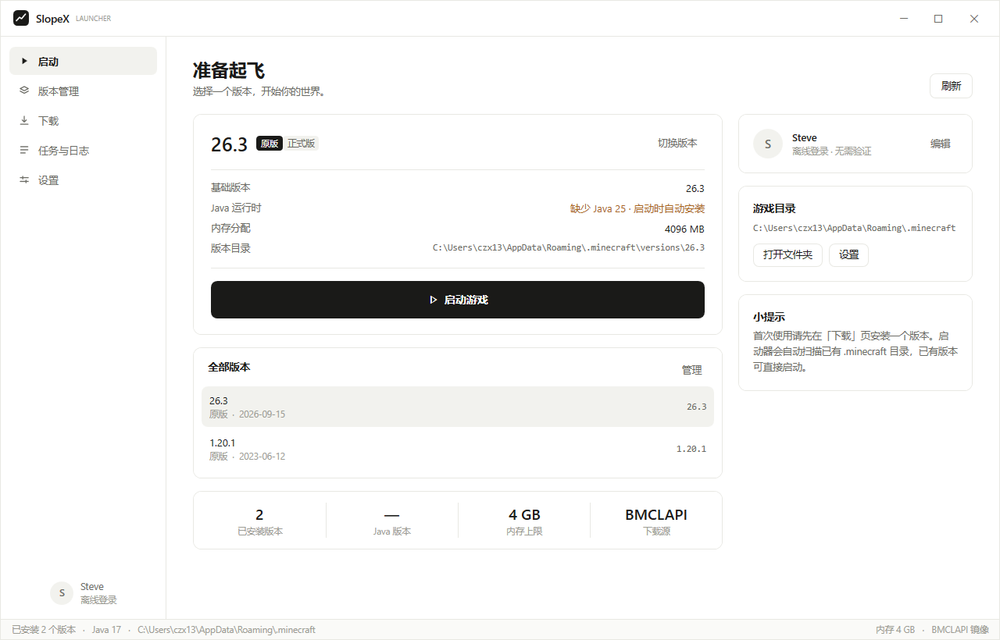
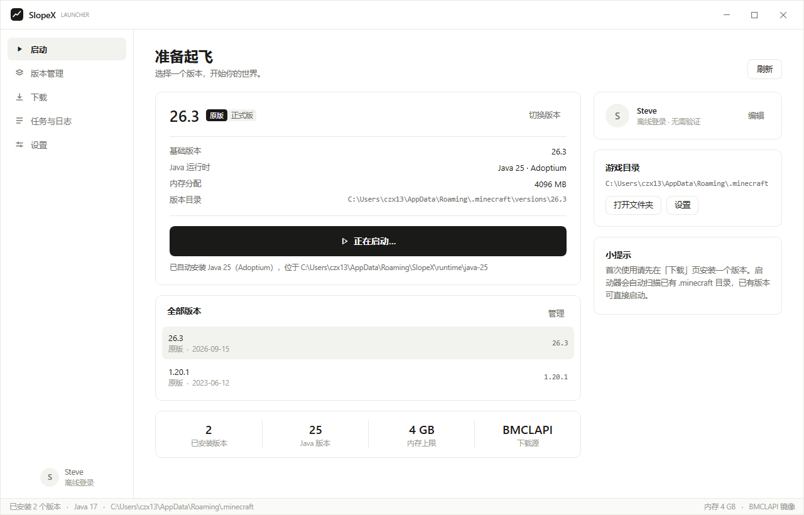

# SlopeX Launcher

一个仿照 [PCL2](https://github.com/Meloong-Git/PCL)（Plain Craft Launcher 2）思路实现的 Minecraft 启动器。
界面风格为**极简白纸**：纯白底、1px 细描边、大留白、单一墨色强调，不使用阴影与彩色渐变。

> 代码为独立实现，未复制 PCL2 源码。仅借鉴其**模块分层方式**与**启动器行为逻辑**。

## 界面

| 启动 | 版本管理 |
|---|---|
|  |  |

| 下载 | 任务与日志 | 设置 |
|---|---|---|
|  |  |  |

缺少所需 Java 时，首页会标黄提示；点「启动游戏」后自动下载安装，装完直接进游戏：

| 缺少 Java 25 | 自动安装完成 |
|---|---|
|  |  |

---

## 技术栈

与 PCL2 同一条技术路线：**.NET + WPF**（PCL2 用 VB.NET，其底层通用库 MeloongCore 本身是 C#）。
本项目使用 C# + WPF，目标框架 `net8.0-windows`，不依赖任何第三方 NuGet 包。

## 架构（对照 PCL2 的模块划分）

```
src/SlopeX/
├─ Modules/
│  ├─ ModBase/       路径、日志、配置、MVVM 基类、JSON 工具
│  ├─ ModNet/        HTTP 访问、镜像重写、并发下载队列（重试 + 校验）
│  ├─ ModMinecraft/  版本扫描、version.json 解析、inheritsFrom 继承链合并、版本隔离目录
│  ├─ ModJava/       Java 探测（注册表 + 目录 + PATH）、版本匹配、缺失时自动下载安装
│  ├─ ModLaunch/     规则引擎、classpath 拼装、natives 解压、参数构造、进程管理
│  ├─ ModDownload/   版本清单、原版安装、资源文件、legacy 资源映射、任务中心
│  └─ ModCli/        无界面命令行模式（自动化测试 / 排障用）
├─ Windows/          主窗口（无边框自绘标题栏）
├─ Pages/            启动 / 版本管理 / 下载 / 任务与日志 / 设置
└─ Themes/Style.xaml 设计令牌与全部控件模板
```

## 已实现的功能

**启动**
- 离线登录（玩家名 → 离线 UUID，算法与原版一致）
- 版本选择、最近版本、启动 / 结束进程、启动后最小化
- 启动参数完整构造：`arguments.jvm` / `arguments.game` / 旧版 `minecraftArguments` 双格式
- 规则引擎：按 `os.name` / `os.arch` / `features` 过滤依赖与参数
- 继承链合并：Forge / Fabric / OptiFine 这类 `inheritsFrom` 版本可正确启动
- natives 解压、log4j 配置注入、classpath 拼装

**下载安装**
- 版本清单（921 个版本）、原版客户端 jar、依赖库、资源文件全量下载
- BMCLAPI 镜像 / Mojang 官方源可选（国内网络建议开镜像）
- 并发下载（依赖库 16 线程、资源 24 线程）、失败重试、大小与 SHA1 校验
- 断点续传语义：已存在且大小匹配的文件自动跳过
- legacy 版本（1.6 以前）资源目录映射（virtual / map_to_resources）

**环境与配置**
- Java 自动探测：注册表 + Program Files / Adoptium / Microsoft / Zulu / Corretto / `.jdks` / PATH
- 按 MC 版本匹配 Java：优先取版本 JSON 的 `javaVersion.majorVersion`（1.17→16，1.18+→17，1.20.5+→21，26.x→25）
- **缺少所需 Java 时自动下载安装**（国内镜像，见下）
- 游戏目录默认 `<启动器目录>\.minecraft`；配置里以相对路径 `.\\.minecraft` 保存，整个文件夹搬走不用改设置
- **版本隔离**：默认开启，每个版本使用 `versions\<版本 ID>` 作为游戏目录，材质包 / 存档 / 模组 / 设置互不影响（`libraries`、`assets` 仍共用）
- 内存、JVM 参数、自定义分辨率、下载源、游戏目录、版本隔离均可配置
- 配置持久化到 `%APPDATA%\SlopeX\config.json`

## 版本隔离

默认开启。开启后传给游戏的 `--gameDir` 是 `.minecraft\versions\<版本 ID>`，于是每个版本各自拥有：

```
.minecraft\versions\<版本 ID>\
├─ mods\          模组
├─ resourcepacks\ 材质包
├─ shaderpacks\   光影
├─ saves\         存档
├─ config\        模组配置
├─ options.txt    游戏设置（按键、音量、视距）
└─ logs\          游戏日志
```

`libraries`、`assets`、`natives` 不按版本复制——它们与版本无关，共用才有意义（一个 1.20.1 的 assets 就占了 1 GB）。

相关行为：

- **首次启用时继承旧数据**：把根目录里的 `mods / resourcepacks / shaderpacks / saves / screenshots / config / options.txt / servers.dat` 复制一份到第一个启动的版本，避免"存档不见了"。只做一次（`IsolationSeeded` 标记），之后新版本从空白开始。
- **手动导入**：「设置 → 游戏目录 → 把公共目录内容导入当前版本」，把根目录内容复制到最近启动的版本（同名文件不覆盖）。
- **关闭隔离**：设置里取消勾选即可回到所有版本共用 `.minecraft`；已产生的版本目录不会被删除，随时可以再打开。
- **删除版本**：会连同该版本的存档、材质包一起删除，确认框会明确提示。

## Java 运行时自动配置

启动前会解析版本 JSON 得到所需 Java 主版本。若本机没有兼容的运行时，自动从国内镜像下载安装，无需用户干预。

- 镜像顺序：**清华 TUNA → 中科大 USTC → 华为云 → Adoptium 官方**（逐个尝试，前一个失败自动换下一个）
- 优先取 **JRE**（约 56 MB）而非 JDK；镜像只有 JDK 时退而用 JDK
- 安装位置：`%APPDATA%\SlopeX\runtime\java-<主版本>`，完成后自动纳入 Java 扫描列表
- 下载过程在首页显示实时进度（百分比 + 已下载/总大小），失败会给出可读原因
- 可在「设置 → Java 运行时」关闭自动下载，或手动指定 Java 路径

判定规则上修正了一个会导致"启动没反应"的问题：**低于要求的 Java 不再被静默选用**。此前的逻辑在找不到足够高版本时会退回列表里最高的那个（例如用 Java 17 去跑需要 Java 25 的 26.3），游戏进程会以退出码 1 秒退。现在改为返回"无兼容 Java"，交由自动安装处理；同时，游戏秒退时首页会直接给出原因（识别 `UnsupportedClassVersionError` 等）。

对于 Java 8 时代的旧版本（≤1.12），只接受 Java 8，不会用高版本 JRE 顶替。

## 运行

已提供免安装单文件版本（就在仓库根目录）：

```
SlopeX.exe
.minecraft/                    ← 游戏根目录（首次启动自动创建）
├─ assets/  libraries/         ← 所有版本共用
└─ versions/<版本 ID>/         ← 版本隔离后的游戏目录（材质包、存档、模组都在这里）
```

**便携模式**：游戏目录默认是 `SlopeX.exe` 所在目录下的 `.minecraft`，配置、存档、模组都在同一个文件夹里，整个文件夹拷到 U 盘或另一台机器即可继续用。配置中存的是相对路径 `.\\.minecraft`，搬到别的盘符也不会失效。若启动器所在目录不可写（例如放进 `Program Files`），会自动回落到 `%APPDATA%\SlopeX\.minecraft`。

> 旧版默认使用 `%APPDATA%\.minecraft`。如果启动器目录下已经存在带 `versions` 的 `.minecraft`，启动时会自动把配置切过来，无需手动改。

源码运行（需要 .NET 8 SDK）：

```bash
dotnet run --project src/SlopeX/SlopeX.csproj
```

命令行模式（不开界面，便于排障）：

```bash
SlopeX.exe --cli list                    # 列出已安装版本
SlopeX.exe --cli java                    # 列出检测到的 Java
SlopeX.exe --cli java-ensure 25          # 确保存在 Java 25，缺失则自动下载安装
SlopeX.exe --cli manifest 20             # 列出可安装版本
SlopeX.exe --cli install 1.20.1          # 安装原版
SlopeX.exe --cli verify 1.20.1           # 校验依赖/资源是否齐全
SlopeX.exe --cli plan 1.20.1             # 打印完整启动命令行（不启动）
SlopeX.exe --cli launch 1.20.1           # 直接启动
```

## 构建

```bash
build.cmd            # 输出自包含单文件到仓库根目录 SlopeX.exe
```

## 已知限制

- **仅支持 Windows**（WPF + 注册表探测）
- **未实现微软正版登录**：需要自行申请 Azure 应用并接入 OAuth 设备码流程，当前为离线登录
- **未实现 Forge / Fabric / NeoForge 的一键安装**：可以启动已由其它启动器装好的整合/模组版本，但安装器本身未实现
- 模组管理、整合包导入尚未实现（版本隔离已支持）
- 版本隔离不支持"共享材质包"这类混合模式：要么全隔离，要么全共用；需要两者兼得时，可用「把公共目录内容导入当前版本」手动同步
- Java 自动下载只覆盖 x64 / arm64 桌面平台，且依赖国内镜像的可达性；镜像全部不可达时需手动指定 Java

## 许可

本项目代码可自由使用。PCL2 采用 LGPL-3.0（仓库标注为 Other），本项目未使用其代码，
如需二次分发请自行确认对 PCL2 名称与素材的使用边界。
